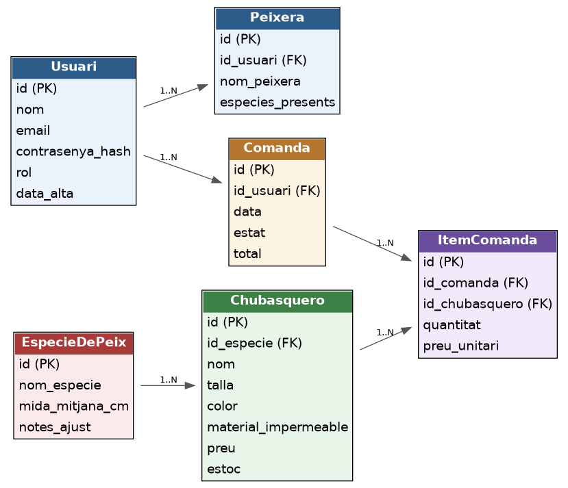

# Backend

**Nom del projecte:** E-commerce Full Stack (xubasquers per a peixos)

**Tecnologies:** React, Node.js/Express, MongoDB (Mongoose), Docker, bcrypt i Postman

**Autor:** (nom complet teu)

API REST del backend de la botiga: CRUD de productes, categories i usuaris, amb validacions, gestió centralitzada d'errors, filtres, ordenació i paginació.

> ⚠️ **Avís de seguretat:** encara no hi ha autenticació (JWT) ni control de rols (RBAC).
> Els endpoints, sobretot `/api/users`, **només s'han d'executar en local i amb dades fictícies**.
> No s'han de desplegar públicament. El registre públic es traslladarà més endavant a
> `/api/auth/register` i la gestió administrativa quedarà protegida.

## Com executar el projecte

### Requisits
- Node.js
- Docker Desktop instal·lat i en execució
- Postman i MongoDB Compass (per provar l'API i comprovar la base de dades)

### 1. 🐳 Base de datos con Docker

La base de datos MongoDB se levanta con Docker Compose.

**Arrancar MongoDB**
```bash
cd Docker
docker compose up -d
```

Esto crea el contenedor `mongo-1` y expone MongoDB en el puerto `27017`.

**Comprobar que está funcionando**
```bash
docker ps
```

Deberías ver el contenedor `mongo-1` con el puerto `27017:27017`.

**Parar el contenedor**
```bash
docker compose down
```

**Cadena de conexión**
```
mongodb://<usuari>:<contrasenya>@localhost:27017/<nombre_base_de_datos>?authSource=admin
```
(L'usuari i la contrasenya són els definits a `Docker/docker-compose.yml`.)

### 2. Variables d'entorn

Copia `api/.env.example` com a `api/index.env` i omple els valors:
```
PORT=3000
MONGO_URI=mongodb://<usuari>:<contrasenya>@localhost:27017/<nom_base_de_dades>?authSource=admin
```
`index.env` està al `.gitignore` i no es puja al repositori.

### 3. Instal·lar i arrencar l'API

```bash
cd api
npm install
npm run dev
```
Ha de sortir «Servidor escoltant al port 3000» i «MongoDB connectat correctament».

### 4. Dades de prova (opcional)

Per veure els filtres i la paginació en funcionament, el projecte inclou un script que crea **25 categories i 25 usuaris fictícios** (un de cada quatre inactiu, amb dates de creació diferents):

```bash
npm run seed         # crea les dades de prova
npm run seed:clean   # elimina només les dades creades per l'script
```

Les categories tenen el slug `seed-...` i els usuaris l'email `seed-user-NN@prova.cat`, per poder-los identificar. La contrasenya fictícia és `contrasenya-segura-1` i es guarda amb hash bcrypt.

## 📁 Estructura del projecte

```
.
├── Docker/
│   └── docker-compose.yml
├── Docs/
│   ├── Adrs/
│   │   ├── ADR-001-base-de-dades.md
│   │   └── ADR-002-estructura-projecte.md
│   └── Diagrams/
│       └── diagrama_domini_chubasqueros_peces.png
├── postman/
│   ├── ecommerce.postman_collection.json
│   └── ecommerce_local.postman_environment.json
├── api/
│   ├── node_modules/
│   ├── src/
│   │   ├── config/
│   │   │   └── db.js
│   │   ├── controllers/
│   │   │   ├── categoryController.js
│   │   │   ├── productController.js
│   │   │   └── userController.js
│   │   ├── middleware/
│   │   │   └── errorHandler.js
│   │   ├── models/
│   │   │   ├── Category.js
│   │   │   ├── Product.js
│   │   │   └── user.js
│   │   ├── routes/
│   │   │   ├── categoryRoutes.js
│   │   │   ├── productRoutes.js
│   │   │   └── userRoutes.js
│   │   ├── services/
│   │   │   ├── categoryService.js
│   │   │   ├── productService.js
│   │   │   └── userService.js
│   │   ├── utils/
│   │   │   ├── AppError.js
│   │   │   └── queryParams.js
│   │   ├── app.js
│   │   ├── index.js
│   │   └── seed.js
│   ├── .env.example
│   ├── .gitignore
│   ├── index.env
│   ├── package-lock.json
│   └── package.json
└── README.md
```

Cada petició segueix el mateix camí: `routes → controllers → services → models → MongoDB`. L'arrencada (`index.js`) connecta amb MongoDB i engega el servidor; `app.js` configura Express, les rutes i el middleware d'errors.

## Models

- **Product:** `name`, `price`, `stock`, `targetSpecies` (llista tancada), `size` (XS–XL), `color`, `category` (referència a Category) i `timestamps`.
- **Category:** `name` (mínim 3), `slug` (obligatori i únic), `description` (màxim 500), `active` (per defecte `true`) i `timestamps`.
- **User:** `name`, `email` (format vàlid i únic), `passwordHash`, `role` (`client`/`admin`), `active` i `timestamps`.

### Exemples de cos de la petició

Categoria:
```json
{ "name": "Electrònica", "slug": "electronica", "description": "Dispositius i accessoris", "active": true }
```
Usuari:
```json
{ "name": "Anna Prova", "email": "anna@prova.cat", "password": "contrasenya-segura-1" }
```

## Endpoints

| Mètode | Endpoint | Operació |
|---|---|---|
| POST | `/api/products` | Crear producte |
| GET | `/api/products` | Llistar productes (amb la categoria poblada) |
| GET | `/api/products/:id` | Consultar producte |
| PUT | `/api/products/:id` | Modificar producte |
| DELETE | `/api/products/:id` | Eliminar producte (204) |
| POST | `/api/categories` | Crear categoria |
| GET | `/api/categories` | Llistar categories (filtres, ordenació i paginació) |
| GET | `/api/categories/:id` | Consultar categoria |
| PUT | `/api/categories/:id` | Modificar categoria |
| DELETE | `/api/categories/:id` | Eliminar categoria (204) |
| POST | `/api/users` | Crear usuari |
| GET | `/api/users` | Llistar usuaris (filtres, ordenació i paginació) |
| GET | `/api/users/:id` | Consultar usuari |
| PUT | `/api/users/:id` | Modificar usuari |
| DELETE | `/api/users/:id` | Desactivar usuari (`active=false`, 204) |

## Filtres, ordenació i paginació

`GET /api/categories` i `GET /api/users` accepten aquests paràmetres (tots opcionals):

| Paràmetre | Descripció | Exemple |
|---|---|---|
| `active` | Filtra per estat: `true` o `false` | `?active=true` |
| `name` | Cerca parcial al nom, sense distingir majúscules | `?name=info` |
| `sort` | Ordena per un camp permès; el prefix `-` indica ordre descendent. Es poden separar diversos camps amb coma | `?sort=name`, `?sort=-createdAt` |
| `page` | Número de pàgina (enter positiu, per defecte 1) | `?page=2` |
| `limit` | Resultats per pàgina (enter positiu, per defecte 10, **màxim 100**) | `?limit=5` |

Camps d'ordenació permesos: categories → `name`, `slug`, `active`, `createdAt`, `updatedAt`; usuaris → `name`, `email`, `role`, `active`, `createdAt`, `updatedAt` (mai `passwordHash`).

Exemples: `GET /api/users?name=anna`, `GET /api/users?sort=-createdAt`, `GET /api/users?page=2&limit=5`, `GET /api/categories?active=true&sort=name&page=1&limit=3`.

Resposta:
```json
{
  "success": true,
  "data": [],
  "pagination": { "page": 1, "limit": 10, "total": 25, "totalPages": 3 }
}
```

- Els valors invàlids retornen un `400 INVALID_QUERY` amb el camp afectat a `details`. Si `limit` supera el màxim, es limita a 100 i la resposta mostra el valor realment aplicat.
- El text de `name` s'escapa, de manera que `name=a.*` es busca com a text literal.
- L'ordenació té un desempat per `_id` perquè la paginació sigui estable, i l'ordre alfabètic és en català.

Per generar dades de prova suficients per veure-ho en funcionament, consulta l'apartat «Dades de prova» (`npm run seed`).

## Validacions i gestió d'errors

Tots els errors passen per un middleware global (`src/middleware/errorHandler.js`) i tenen el mateix format. Mai s'envien traces internes ni dades sensibles; la traça d'un error inesperat només es veu a la consola del servidor.

```json
{
  "success": false,
  "error": {
    "code": "VALIDATION_ERROR",
    "message": "Les dades no són vàlides",
    "details": [{ "field": "name", "message": "El nom és obligatori" }]
  }
}
```

Les respostes correctes tenen el format `{ "success": true, "data": ... }`. Eliminar o desactivar retorna `204 No Content` sense cos.

| Codi HTTP | `error.code` | Quan passa |
|---|---|---|
| 400 | `INVALID_ID` | ID amb format incorrecte (`/api/categories/123`) |
| 400 | `FIELDS_NOT_ALLOWED` | El cos conté camps no permesos (`role`, `active`, `passwordHash`) |
| 400 | `INVALID_QUERY` | Paràmetres de consulta invàlids (`page=0`, `limit=abc`, `sort` no permès, `active=maybe`) |
| 400 | `NO_FIELDS` | Un `PUT` d'usuari sense cap camp per modificar |
| 400 | `INVALID_JSON` | El cos de la petició no és un JSON vàlid |
| 404 | `NOT_FOUND` | El recurs no existeix (usuari, categoria o producte) |
| 404 | `ROUTE_NOT_FOUND` | La ruta no existeix |
| 409 | `DUPLICATE_KEY` | Slug de categoria o email d'usuari duplicat (índex únic) |
| 422 | `VALIDATION_ERROR` | Error de validació (camp obligatori, mínim, format, contrasenya curta...) |
| 500 | `INTERNAL_ERROR` | Error inesperat del servidor |

Com funciona:
- Els controladors no tenen `try/catch`: Express 5 envia automàticament al middleware qualsevol error d'una funció `async`.
- Els errors de Mongoose (`ValidationError`, `CastError`) i el codi `11000` de MongoDB (índex únic) es converteixen a l'estructura anterior.
- Els errors propis es llancen amb `AppError` (`src/utils/AppError.js`).

## Decisions de seguretat dels usuaris

- La contrasenya (mínim 12 caràcters) es transforma en hash amb **bcrypt**. No es guarda ni es retorna mai en text pla.
- `passwordHash` no apareix a cap resposta de l'API.
- El servidor assigna sempre `role = client`. El cos de la petició només pot portar `name`, `email` i `password`; qualsevol altre camp (`role`, `active`, `passwordHash`) es rebutja amb un 400.
- L'email duplicat es detecta amb l'índex únic de MongoDB (error 11000) i retorna un 409.
- `DELETE /api/users/:id` fa una baixa lògica (`active=false`); el document es conserva.

## Postman

1. Importa `postman/ecommerce.postman_collection.json` i `postman/ecommerce_local.postman_environment.json`.
2. Selecciona l'entorn **Ecommerce Local** (`baseUrl = http://localhost:3000`).
3. Executa les carpetes **Products**, **Categories** i **Users** en ordre (o amb el *Collection Runner*). Les peticions guarden els identificadors en variables de la col·lecció i porten proves automàtiques.
4. Per exportar la col·lecció: menú de tres punts de «Ecommerce API» → **Export** → **Collection v2.1**, i es desa a `postman/ecommerce.postman_collection.json`. La col·lecció no conté secrets: només la variable `baseUrl` i dades fictícies.

## Documentació

- **`Docs/Adrs/ADR-001-base-de-dades.md`** — Es tria **MongoDB** (via Docker) per la flexibilitat del catàleg, amb atributs heterogenis com talla, color, material impermeable o espècie de peix objectiu.
- **`Docs/Adrs/ADR-002-estructura-projecte.md`** — Es tria un **monorepo**, amb backend, frontend i documentació en carpetes separades del mateix repositori.
- **`Docs/Diagrams/diagrama_domini_chubasqueros_peces.png`** — Diagrama de domini (usuaris, comandes, productes i espècies).

