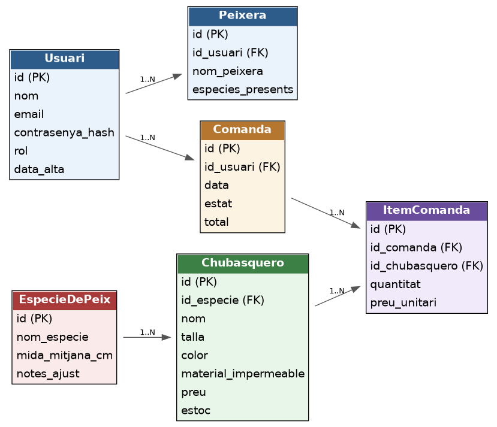

# Backend

**Nom del projecte:** E-commerce Full Stack (xubasquers per a peixos)

**Tecnologies:** React, Node.js/Express 5, MongoDB (Mongoose), Docker, bcrypt, JWT (jsonwebtoken) i Postman

**Autor:** (nom complet teu)

API REST del backend de la botiga: CRUD de productes, categories i usuaris, amb validacions, gestió centralitzada d'errors, filtres, ordenació i paginació, i **registre i login d'usuaris amb bcrypt i JWT**.

> ⚠️ **Avís de seguretat:** l'autenticació (JWT) ja funciona a `/api/auth`, però **encara no hi ha control de rols (RBAC)**
> i només `GET /api/auth/me` està protegit. Els endpoints de `/api/users`, `/api/products` i `/api/categories`
> continuen oberts, així que **només s'han d'executar en local i amb dades fictícies**.
> No s'han de desplegar públicament fins que quedin protegits amb `authenticate` i amb comprovació de rol.

## Com executar el projecte

### Requisits
- Node.js
- Docker Desktop instal·lat i en execució
- Postman i MongoDB Compass (per provar l'API i comprovar la base de dades)

### 1. 🐳 Base de datos con Docker

La base de datos MongoDB se levanta con Docker Compose.

**Arrancar MongoDB**
```bash
cd Docker
docker compose up -d
```

Esto crea el contenedor de MongoDB (servicio `mongo`) y expone MongoDB en el puerto `27017`. Los datos se guardan en el volumen `mongo_data`.

**Comprobar que está funcionando**
```bash
docker ps
```

Deberías ver el contenedor de MongoDB con el puerto `27017:27017`.

**Parar el contenedor**
```bash
docker compose down
```

**Cadena de conexión**
```
mongodb://<usuari>:<contrasenya>@localhost:27017/<nombre_base_de_datos>?authSource=admin
```
(L'usuari i la contrasenya són els definits a `Docker/docker-compose.yml`, a `MONGO_INITDB_ROOT_USERNAME` i `MONGO_INITDB_ROOT_PASSWORD`.)

### 2. Variables d'entorn

Copia `api/.env.example` com a `api/index.env` i omple els valors:
```
PORT=3000
MONGO_URI=mongodb://<usuari>:<contrasenya>@localhost:27017/<nom_base_de_dades>?authSource=admin
JWT_SECRET=<secret de mínim 32 caràcters>
JWT_EXPIRES_IN=1h
```

| Variable | Descripció |
|---|---|
| `PORT` | Port on escolta l'API (per defecte 3000) |
| `MONGO_URI` | Cadena de connexió a MongoDB |
| `JWT_SECRET` | Secret per signar els tokens. **Obligatori, mínim 32 caràcters**: si falta o és massa curt, l'API no arrenca |
| `JWT_EXPIRES_IN` | Durada del token (per defecte `1h`) |

Per generar un secret segur:
```bash
node -e "console.log(require('crypto').randomBytes(48).toString('hex'))"
```

`index.env` està al `.gitignore` i no es puja al repositori. Mai no publiquis el `JWT_SECRET` real.

### 3. Instal·lar i arrencar l'API

```bash
cd api
npm install
npm run dev
```
Ha de sortir «Servidor escoltant al port 3000» i «MongoDB connectat correctament».

### 4. Dades de prova (opcional)

Per veure els filtres i la paginació en funcionament, el projecte inclou un script que crea **25 categories i 25 usuaris fictícios** (un de cada quatre inactiu, amb dates de creació diferents):

```bash
npm run seed         # crea les dades de prova
npm run seed:clean   # elimina només les dades creades per l'script
```

Les categories tenen el slug `seed-...` i els usuaris l'email `seed-user-NN@prova.cat`, per poder-los identificar. La contrasenya fictícia és `contrasenya-segura-1` i es guarda amb hash bcrypt (amb aquests usuaris també pots provar el login).

### Scripts disponibles (`api/package.json`)

| Script | Què fa |
|---|---|
| `npm run dev` | Arrenca l'API amb nodemon (`src/index.js`) |
| `npm run seed` | Crea les dades de prova |
| `npm run seed:clean` | Elimina les dades de prova |

## 📁 Estructura del projecte

```
.
├── Docker/
│   └── docker-compose.yml
├── Docs/
│   ├── Adrs/
│   │   ├── ADR-001-base-de-dades.md
│   │   └── ADR-002-estructura-projecte.md
│   └── Diagrams/
│       └── diagrama_domini_chubasqueros_peces.png
├── postman/
│   ├── ecommerce.postman_collection.json
│   └── ecommerce_local.postman_environment.json
├── api/
│   ├── node_modules/
│   ├── postman/                       (espai de treball local de Postman)
│   │   ├── collections/Ecommerce API/ (Categories, Products, Users)
│   │   └── environments/
│   ├── src/
│   │   ├── config/
│   │   │   ├── db.js
│   │   │   └── jwt.js
│   │   ├── controllers/
│   │   │   ├── authController.js
│   │   │   ├── categoryController.js
│   │   │   ├── productController.js
│   │   │   └── userController.js
│   │   ├── middleware/
│   │   │   ├── authenticate.js
│   │   │   └── errorHandler.js
│   │   ├── models/
│   │   │   ├── Category.js
│   │   │   ├── Product.js
│   │   │   └── user.js
│   │   ├── routes/
│   │   │   ├── authRoutes.js
│   │   │   ├── categoryRoutes.js
│   │   │   ├── productRoutes.js
│   │   │   └── userRoutes.js
│   │   ├── services/
│   │   │   ├── authService.js
│   │   │   ├── categoryService.js
│   │   │   ├── productService.js
│   │   │   └── userService.js
│   │   ├── utils/
│   │   │   ├── AppError.js
│   │   │   ├── password.js
│   │   │   └── queryParams.js
│   │   ├── app.js
│   │   ├── index.js
│   │   └── seed.js
│   ├── .env.example
│   ├── .gitignore
│   ├── index.env
│   ├── package-lock.json
│   └── package.json
└── README.md
```

Cada petició segueix el mateix camí: `routes → controllers → services → models → MongoDB`. L'arrencada (`index.js`) carrega `index.env`, comprova que `JWT_SECRET` és vàlid, connecta amb MongoDB i engega el servidor; `app.js` configura Express, les rutes (`/api/products`, `/api/categories`, `/api/users`, `/api/auth`) i el middleware d'errors.

## Models

- **Product:** `name`, `price`, `stock`, `targetSpecies` (llista tancada), `size` (XS–XL), `color`, `category` (referència a Category) i `timestamps`.
- **Category:** `name` (mínim 3), `slug` (obligatori i únic), `description` (màxim 500), `active` (per defecte `true`) i `timestamps`.
- **User:** `name`, `email` (format vàlid i únic), `passwordHash` (`select: false`, no surt mai a les respostes), `role` (`client`/`admin`), `active` i `timestamps`.

### Exemples de cos de la petició

Categoria:
```json
{ "name": "Electrònica", "slug": "electronica", "description": "Dispositius i accessoris", "active": true }
```
Usuari / registre:
```json
{ "name": "Anna Prova", "email": "anna@prova.cat", "password": "contrasenya-segura-1" }
```
Login:
```json
{ "email": "anna@prova.cat", "password": "contrasenya-segura-1" }
```

## Endpoints

| Mètode | Endpoint | Operació | Protegit |
|---|---|---|---|
| POST | `/api/auth/register` | Registrar usuari (retorna usuari i token, 201) | No |
| POST | `/api/auth/login` | Iniciar sessió (retorna usuari i token, 200) | No |
| GET | `/api/auth/me` | Consultar el perfil de l'usuari autenticat | Sí (Bearer) |
| POST | `/api/products` | Crear producte | No |
| GET | `/api/products` | Llistar productes (amb la categoria poblada) | No |
| GET | `/api/products/:id` | Consultar producte | No |
| PUT | `/api/products/:id` | Modificar producte | No |
| DELETE | `/api/products/:id` | Eliminar producte (204) | No |
| POST | `/api/categories` | Crear categoria | No |
| GET | `/api/categories` | Llistar categories (filtres, ordenació i paginació) | No |
| GET | `/api/categories/:id` | Consultar categoria | No |
| PUT | `/api/categories/:id` | Modificar categoria | No |
| DELETE | `/api/categories/:id` | Eliminar categoria (204) | No |
| POST | `/api/users` | Crear usuari | No |
| GET | `/api/users` | Llistar usuaris (filtres, ordenació i paginació) | No |
| GET | `/api/users/:id` | Consultar usuari | No |
| PUT | `/api/users/:id` | Modificar usuari | No |
| DELETE | `/api/users/:id` | Desactivar usuari (`active=false`, 204) | No |

## Autenticació (registre, login i JWT)

**Registre** — `POST /api/auth/register` reutilitza la creació d'usuari: valida les dades, guarda la contrasenya amb hash bcrypt i assigna `role = client`. Retorna `201` amb l'usuari i un token.

**Login** — `POST /api/auth/login` rep només `email` i `password`. Retorna `200` amb l'usuari i un token.

```json
{
  "success": true,
  "data": {
    "user": { "_id": "...", "name": "Anna Prova", "email": "anna@prova.cat", "role": "client", "active": true },
    "token": "<jwt>"
  }
}
```

**Perfil** — `GET /api/auth/me` exigeix la capçalera:
```
Authorization: Bearer <token>
```
El middleware `authenticate` verifica el token, carrega l'usuari i el deixa a `req.user`. Retorna les dades de l'usuari autenticat.

**Com funciona el token:**
- Es signa amb `JWT_SECRET` i l'algorisme **HS256** (és l'únic acceptat, així es rebutgen tokens amb `alg: none` o altres algorismes).
- El payload només porta l'identificador (`sub`) i el rol (`role`); mai la contrasenya.
- Caduca segons `JWT_EXPIRES_IN` (per defecte 1 hora).
- En verificar-lo, es comprova que l'usuari encara existeix i està actiu; si no, el token deixa de ser vàlid.

**Mesures de seguretat del login:**
- Email inexistent, contrasenya incorrecta i usuari inactiu retornen **el mateix error** (`401 INVALID_CREDENTIALS`), perquè no es pugui saber si un email està registrat.
- Es compara sempre amb bcrypt, encara que l'email no existeixi (hash fals), per evitar diferències de temps de resposta.
- `email` i `password` han de ser text: així s'eviten injeccions tipus `{ "email": { "$ne": null } }`.
- L'email es normalitza (minúscules i sense espais) abans de buscar l'usuari.
- Qualsevol camp que no sigui `email` o `password` es rebutja amb un 400.

## Filtres, ordenació i paginació

`GET /api/categories` i `GET /api/users` accepten aquests paràmetres (tots opcionals):

| Paràmetre | Descripció | Exemple |
|---|---|---|
| `active` | Filtra per estat: `true` o `false` | `?active=true` |
| `name` | Cerca parcial al nom, sense distingir majúscules | `?name=info` |
| `sort` | Ordena per un camp permès; el prefix `-` indica ordre descendent. Es poden separar diversos camps amb coma | `?sort=name`, `?sort=-createdAt` |
| `page` | Número de pàgina (enter positiu, per defecte 1) | `?page=2` |
| `limit` | Resultats per pàgina (enter positiu, per defecte 10, **màxim 100**) | `?limit=5` |

Camps d'ordenació permesos: categories → `name`, `slug`, `active`, `createdAt`, `updatedAt`; usuaris → `name`, `email`, `role`, `active`, `createdAt`, `updatedAt` (mai `passwordHash`).

Exemples: `GET /api/users?name=anna`, `GET /api/users?sort=-createdAt`, `GET /api/users?page=2&limit=5`, `GET /api/categories?active=true&sort=name&page=1&limit=3`.

Resposta:
```json
{
  "success": true,
  "data": [],
  "pagination": { "page": 1, "limit": 10, "total": 25, "totalPages": 3 }
}
```

- Els valors invàlids retornen un `400 INVALID_QUERY` amb el camp afectat a `details`. Si `limit` supera el màxim, es limita a 100 i la resposta mostra el valor realment aplicat.
- El text de `name` s'escapa, de manera que `name=a.*` es busca com a text literal.
- L'ordenació té un desempat per `_id` perquè la paginació sigui estable, i l'ordre alfabètic és en català.

Per generar dades de prova suficients per veure-ho en funcionament, consulta l'apartat «Dades de prova» (`npm run seed`).

## Validacions i gestió d'errors

Tots els errors passen per un middleware global (`src/middleware/errorHandler.js`) i tenen el mateix format. Mai s'envien traces internes ni dades sensibles; la traça d'un error inesperat només es veu a la consola del servidor.

```json
{
  "success": false,
  "error": {
    "code": "VALIDATION_ERROR",
    "message": "Les dades no són vàlides",
    "details": [{ "field": "name", "message": "El nom és obligatori" }]
  }
}
```

Les respostes correctes tenen el format `{ "success": true, "data": ... }`. Eliminar o desactivar retorna `204 No Content` sense cos.

| Codi HTTP | `error.code` | Quan passa |
|---|---|---|
| 400 | `INVALID_ID` | ID amb format incorrecte (`/api/categories/123`) |
| 400 | `INVALID_DATA` | Un camp té un tipus incorrecte (error de cast que no és l'`_id`) |
| 400 | `FIELDS_NOT_ALLOWED` | El cos conté camps no permesos (`role`, `active`, `passwordHash`; al login, qualsevol camp que no sigui `email`/`password`) |
| 400 | `INVALID_QUERY` | Paràmetres de consulta invàlids (`page=0`, `limit=abc`, `sort` no permès, `active=maybe`) |
| 400 | `NO_FIELDS` | Un `PUT` d'usuari sense cap camp per modificar |
| 400 | `INVALID_JSON` | El cos de la petició no és un JSON vàlid |
| 401 | `UNAUTHORIZED` | Falta la capçalera `Authorization: Bearer <token>` |
| 401 | `INVALID_CREDENTIALS` | Login amb email o contrasenya incorrectes, o usuari inactiu |
| 401 | `TOKEN_EXPIRED` | El token ha caducat |
| 401 | `INVALID_TOKEN` | El token no és vàlid, o l'usuari ja no existeix o està inactiu |
| 404 | `NOT_FOUND` | El recurs no existeix (usuari, categoria o producte) |
| 404 | `ROUTE_NOT_FOUND` | La ruta no existeix |
| 409 | `DUPLICATE_KEY` | Slug de categoria o email d'usuari duplicat (índex únic) |
| 422 | `VALIDATION_ERROR` | Error de validació (camp obligatori, mínim, format, contrasenya curta, camps buits al login...) |
| 500 | `INTERNAL_ERROR` | Error inesperat del servidor |

Com funciona:
- Els controladors no tenen `try/catch`: Express 5 envia automàticament al middleware qualsevol error d'una funció `async`.
- Els errors de Mongoose (`ValidationError`, `CastError`) i el codi `11000` de MongoDB (índex únic) es converteixen a l'estructura anterior.
- Els errors propis es llancen amb `AppError` (`src/utils/AppError.js`).

## Decisions de seguretat dels usuaris

- La contrasenya (mínim 12 caràcters, màxim 72 bytes, límit de bcrypt) es transforma en hash amb **bcrypt** (12 rondes de salt). No es guarda ni es retorna mai en text pla.
- `passwordHash` no apareix a cap resposta de l'API (`select: false` al model i `toJSON` que l'elimina).
- El servidor assigna sempre `role = client`. El cos de la petició només pot portar `name`, `email` i `password`; qualsevol altre camp (`role`, `active`, `passwordHash`) es rebutja amb un 400.
- L'email duplicat es detecta amb l'índex únic de MongoDB (error 11000) i retorna un 409.
- `DELETE /api/users/:id` fa una baixa lògica (`active=false`); el document es conserva, i aquest usuari ja no pot iniciar sessió.
- L'API no arrenca si `JWT_SECRET` falta o té menys de 32 caràcters.

## Postman

1. Importa `postman/ecommerce.postman_collection.json` i `postman/ecommerce_local.postman_environment.json`.
2. Selecciona l'entorn **Ecommerce Local** (`baseUrl = http://localhost:3000`).
3. Executa les carpetes **Products**, **Categories** i **Users** en ordre (o amb el *Collection Runner*). Les peticions guarden els identificadors en variables de la col·lecció (`productId`, `categoryId`, `userId`...) i porten proves automàtiques.
4. Per exportar la col·lecció: menú de tres punts de «Ecommerce API» → **Export** → **Collection v2.1**, i es desa a `postman/ecommerce.postman_collection.json`. La col·lecció no conté secrets: només la variable `baseUrl` i dades fictícies.

Per provar `/api/auth` fes `POST /api/auth/register` o `POST /api/auth/login`, copia el `token` de la resposta i envia'l a `GET /api/auth/me` a la pestanya **Authorization** (tipus *Bearer Token*).

La carpeta `api/postman/` i `api/.postman/` són l'espai de treball local de Postman (vista local) i contenen les mateixes peticions en format YAML.

## Per què s'utilitza cada cosa

### Tecnologies i eines

| Eina | Per què es fa servir |
|---|---|
| **Node.js + Express 5** | Permet fer l'API amb JavaScript, el mateix llenguatge que el frontend (React). Express 5 envia automàticament al middleware d'errors qualsevol error d'una funció `async`, per això els controladors no necessiten `try/catch`. |
| **MongoDB** | El catàleg és heterogeni (talla, color, espècie de peix...) i es preveu afegir atributs nous sovint; amb documents no cal canviar cap taula (vegeu l'ADR-001). |
| **Mongoose** | Afegeix esquemes i validacions (`required`, `min`, `enum`, `match`) a MongoDB, que per si sol no en té, i facilita les referències entre col·leccions (`ref` + `populate`). |
| **Docker / Docker Compose** | Aixeca MongoDB amb una sola comanda i la mateixa configuració a qualsevol ordinador, sense instal·lar-lo a mà. El volum `mongo_data` fa que les dades no es perdin en aturar el contenidor. |
| **dotenv + `index.env`** | Separa la configuració i els secrets (connexió a la base de dades, `JWT_SECRET`) del codi. El fitxer no es puja a GitHub; `.env.example` mostra quines variables calen sense revelar-ne els valors. |
| **bcrypt** | Guarda les contrasenyes com a hash lent i amb salt, de manera que, si la base de dades es filtra, no es poden llegir ni reutilitzar fàcilment. No es pot desfer: només es pot comparar. |
| **jsonwebtoken (JWT)** | Després del login el servidor dona un token signat i el client l'envia a cada petició. L'API no guarda sessions al servidor (*stateless*) i escala més fàcilment. |
| **nodemon** | Reinicia l'API automàticament quan es canvia un fitxer, només en desenvolupament (`devDependencies`). |
| **Postman** | Prova els endpoints sense frontend i, amb les proves automàtiques de la col·lecció, comprova que cada cas (èxit, 400, 404, 409, 422...) respon com toca. |
| **MongoDB Compass** | Permet comprovar visualment què s'ha guardat realment (per exemple, que hi ha `passwordHash` i no la contrasenya). |
| **Script de seed** | Crea dades fictícies perquè es vegin els filtres, l'ordenació i la paginació sense haver d'inserir registres a mà. Només esborra el que ell mateix ha creat (prefix `seed-`). |
| **ADRs** | Deixen per escrit el motiu de les decisions importants (base de dades, estructura) perquè es puguin entendre i revisar més endavant. |
| **Monorepo** | Un sol repositori per al backend, el frontend i la documentació: els canvis que afecten tots dos es revisen junts (ADR-002). |

### Arquitectura en capes

| Capa | Per què existeix |
|---|---|
| **`routes`** | Només diuen quina URL i mètode porta a quin controlador. És el lloc on es posa la protecció (`authenticate`) a cada ruta. |
| **`controllers`** | Reben la petició i construeixen la resposta HTTP (codi d'estat i JSON). No tenen lògica de negoci. |
| **`services`** | Contenen la lògica real (validar camps, fer el hash, consultar). Estan separats perquè es puguin reutilitzar: `register` crida `userService.createUser` en lloc de repetir les regles. |
| **`models`** | Defineixen la forma de les dades i les seves validacions en un sol lloc. |
| **`middleware`** | Codi que s'executa entre la petició i el controlador (`authenticate`) o al final de tot (`errorHandler`). |
| **`config`** | Agrupa la configuració (connexió a la base de dades, regles del JWT) perquè no estigui escampada pel codi. |
| **`utils`** | Peces petites i reutilitzables: `AppError` (errors propis), `password` (regles i hash), `queryParams` (filtres, ordenació i paginació). |

### Decisions de seguretat i disseny

| Decisió | Per què |
|---|---|
| Contrasenya de mínim 12 caràcters | Com més llarga, més difícil d'endevinar per força bruta. |
| Màxim 72 bytes a la contrasenya | bcrypt ignora tot el que passa de 72 bytes; així no hi ha contrasenyes que sembla que són més llargues del que realment són. |
| 12 rondes de salt | Fa el hash prou lent per dificultar atacs massius, però sense alentir massa el login. |
| `passwordHash` amb `select: false` i eliminat a `toJSON` | Doble protecció perquè el hash no surti mai en una resposta, ni per error. |
| El `role` el posa el servidor (sempre `client`) | Si el client el pogués enviar, qualsevol es podria registrar com a `admin`. |
| Llista de camps permesos (`FIELDS_NOT_ALLOWED`) | Rebutja camps que no s'haurien de poder tocar (`role`, `active`, `passwordHash`) en lloc d'ignorar-los en silenci. |
| Baixa lògica (`active=false`) | Es conserva l'historial (futures comandes, per exemple) i es pot reactivar; l'usuari desactivat ja no pot entrar. |
| Mateix error al login (`INVALID_CREDENTIALS`) | Si diguéssim «email inexistent» o «contrasenya incorrecta» per separat, un atacant podria saber quins emails estan registrats. |
| Hash fals (`DUMMY_HASH`) quan l'email no existeix | Fa que la resposta trigui el mateix, perquè el temps de resposta tampoc revele si l'email existeix. |
| `email` i `password` han de ser text | Evita la injecció NoSQL (`{ "email": { "$ne": null } }`). |
| Email en minúscules i sense espais | Evita duplicats com `Anna@x.cat` i `anna@x.cat`. |
| Només l'algorisme HS256 al JWT | Impedeix acceptar tokens amb `alg: none` o amb un algorisme que l'atacant hagi triat. |
| Payload del JWT només amb `sub` i `role` | El token es pot llegir (només està signat, no xifrat), així que no ha de portar dades sensibles. |
| Token de curta durada (`1h`) | Si es roba, només serveix un temps limitat. |
| `JWT_SECRET` de mínim 32 caràcters i l'API no arrenca sense ell | És preferible fallar en arrencar que signar tokens amb un secret feble. |
| `authenticate` comprova que l'usuari encara existeix i està actiu | Un token vàlid d'un usuari desactivat no ha de donar accés. |
| Errors amb format únic i sense traces | El frontend els pot tractar sempre igual, i no es filtren detalls interns a un possible atacant. |
| Codis HTTP diferents (400, 401, 404, 409, 422, 500) | Cada codi diu quin tipus de problema és: petició mal feta, no autenticat, no trobat, duplicat o dades invàlides. |
| `limit` màxim de 100 | Evita que una sola petició demani milers de registres i saturi el servidor. |
| `name` escapat a la cerca | Es busca com a text literal; sense escapar, un usuari podria enviar una expressió regular costosa. |
| Camps d'ordenació en llista blanca | No es pot ordenar per `passwordHash` ni per camps interns. |
| Desempat per `_id` i collation `ca` | La paginació és estable (no es repeteixen ni es perden resultats) i l'ordre alfabètic respecta el català. |
| Enums exportats (`TARGET_SPECIES`, `SIZES`) | El frontend pot reutilitzar les mateixes llistes als desplegables. |

## Documentació

- **`Docs/Adrs/ADR-001-base-de-dades.md`** — Es tria **MongoDB** (via Docker) per la flexibilitat del catàleg, amb atributs heterogenis com talla, color, material impermeable o espècie de peix objectiu.
- **`Docs/Adrs/ADR-002-estructura-projecte.md`** — Es tria un **monorepo**, amb backend, frontend i documentació en carpetes separades del mateix repositori.
- **`Docs/Diagrams/diagrama_domini_chubasqueros_peces.png`** — Diagrama de domini (usuaris, comandes, productes i espècies).

